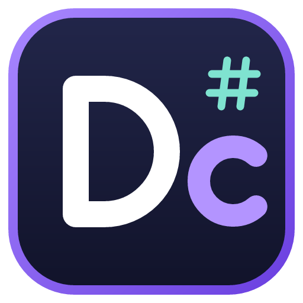
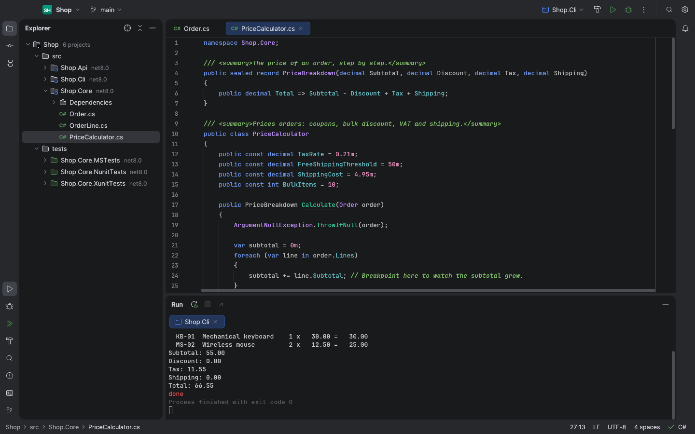
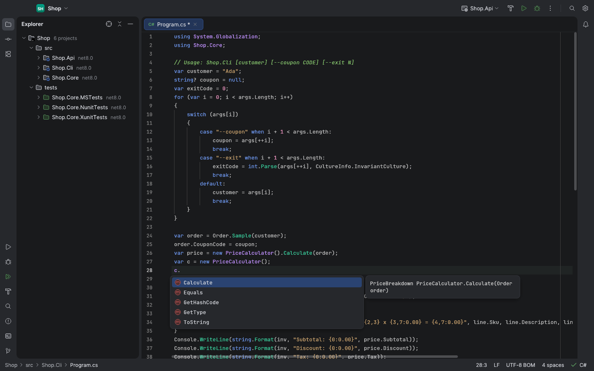
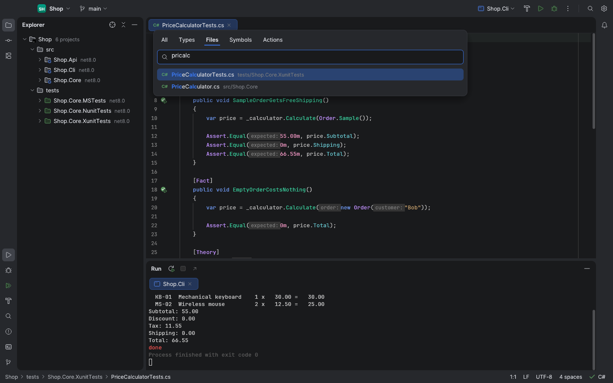
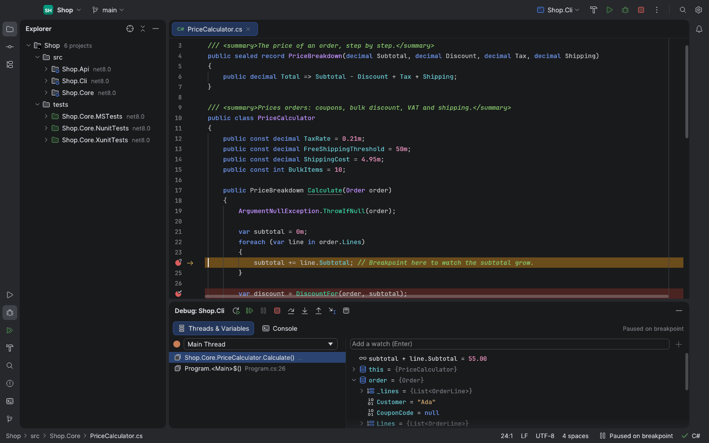
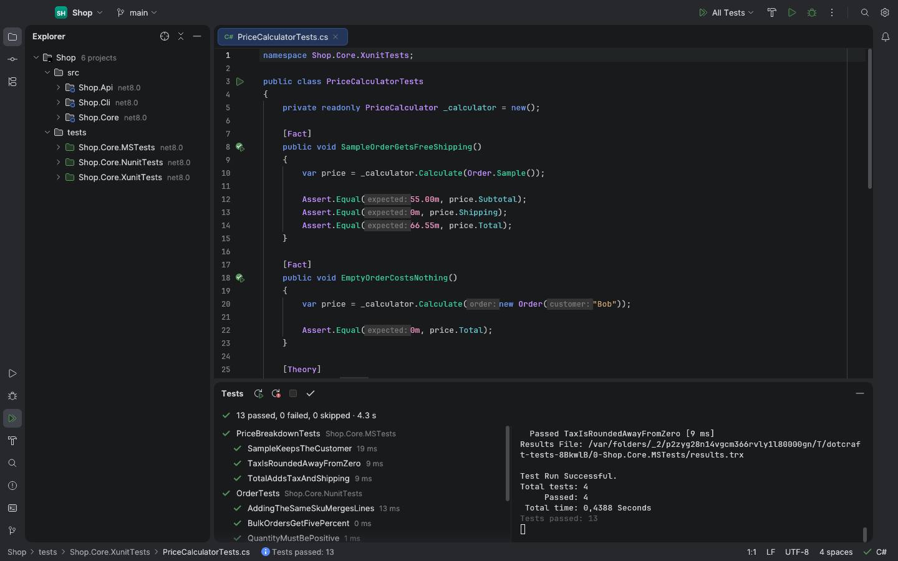
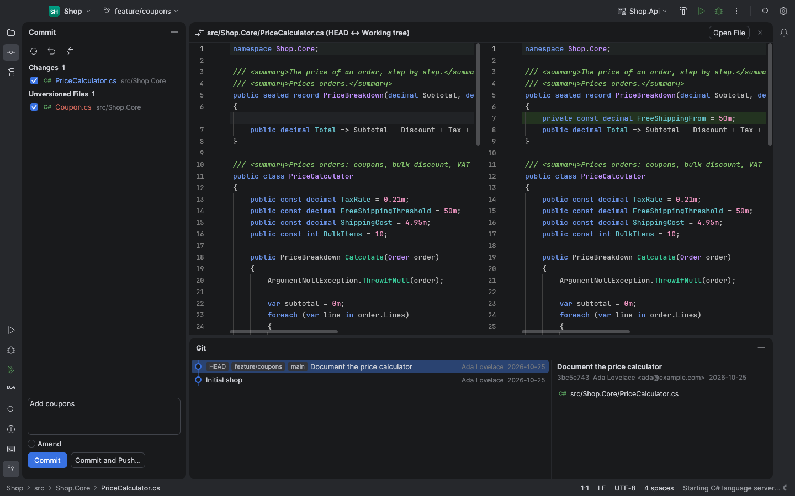
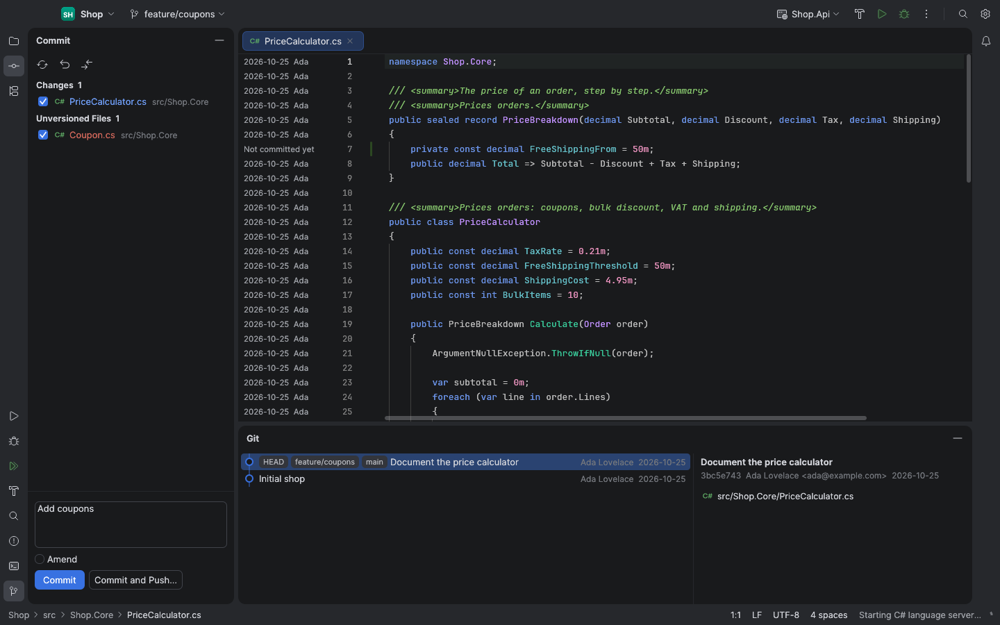

<p align="center">
  
</p>

<h1 align="center">DotCraft</h1>

<p align="center">
  <strong>A lightweight, native IDE for .NET and C#.</strong><br>
  Solutions, Roslyn code intelligence, build, run, tests, debugging and Git in a fast desktop app built with Rust and egui.<br>
  macOS · Windows · Linux
</p>

<p align="center">
  <a href="LICENSE-MIT"></a>
  
  
</p>

<p align="center">
  <a href="#highlights">Highlights</a> ·
  <a href="#requirements">Requirements</a> ·
  <a href="#build-from-source">Build</a> ·
  <a href="#keyboard">Keyboard</a> ·
  <a href="#architecture">Architecture</a> ·
  <a href="#license">License</a>
</p>

<p align="center">
  <picture>
    <source media="(prefers-color-scheme: light)" srcset="docs/screenshots/workspace-light.png">
    
  </picture>
  <br>
  <sub>A solution open in DotCraft. Light and dark themes follow the system.</sub>
</p>

DotCraft takes its layout and keyboard from JetBrains Rider's New UI — islands, tool window stripes, Search Everywhere, the Rider keymap — and runs as a single native binary that starts in a moment and stays responsive on large files. Screenshots are offscreen captures of the current source build on macOS with the sample solution in `tests/fixtures/Shop`.

## Highlights

| Edit | Build and debug | Navigate and review |
| --- | --- | --- |
| A custom editor with tree-sitter highlighting, folding, multi-caret editing and Roslyn semantic colors, completion, signature help, quick fixes, rename and inlay hints. | Build, run and test (xUnit, NUnit, MSTest) with the dotnet CLI; debug console and ASP.NET apps with netcoredbg; manage NuGet packages. | Search Everywhere, Find in Files, recent files and locations, an integrated terminal, and Git: changes, commit, branches, side-by-side diff, gutter marks and blame. |

### Code intelligence

DotCraft talks to the same C# language server as Visual Studio Code's C# extension (`Microsoft.CodeAnalysis.LanguageServer`). It finds an installed copy or downloads it on first use. Completion, hover, go to definition and implementations, find usages, cross-project rename, code actions and diagnostics come from Roslyn; syntax colors and structure come from tree-sitter, so the editor is useful before the server is ready.

<table>
  <tr>
    <td width="50%"></td>
    <td width="50%"></td>
  </tr>
  <tr>
    <td align="center"><sub>Completion with documentation.</sub></td>
    <td align="center"><sub>Search Everywhere (⇧⇧) with fuzzy matching.</sub></td>
  </tr>
</table>

### Run, test and debug

Run configurations are created from the solution: one per executable project and launch profile, plus the tests of each test project. Build errors go to the Problems window with links to the code; test results show in a tree and as gutter icons next to each test.

The debugger uses [netcoredbg](https://github.com/Samsung/netcoredbg) (MIT), downloaded on first use. It supports line and conditional breakpoints, step over/into/out, Run to Cursor, threads and frames, a lazily expanded variables tree, watches, Evaluate Expression, values on hover and stopping on exceptions.

<table>
  <tr>
    <td width="50%"></td>
    <td width="50%"></td>
  </tr>
  <tr>
    <td align="center"><sub>Paused on a conditional breakpoint.</sub></td>
    <td align="center"><sub>Tests from three frameworks in one run.</sub></td>
  </tr>
</table>

### Git

<table>
  <tr>
    <td width="50%"></td>
    <td width="50%"></td>
  </tr>
  <tr>
    <td align="center"><sub>Side-by-side diff with the editor's highlighting.</sub></td>
    <td align="center"><sub>Blame in the gutter.</sub></td>
  </tr>
</table>

## Requirements

- macOS 11 or later (Apple Silicon or Intel), Windows 10/11 (x64 or ARM64, DirectX 12), or Linux with glibc 2.35+ (x64 or ARM64; Vulkan or OpenGL ES, X11 or Wayland).
- The [.NET SDK](https://dotnet.microsoft.com/download) 8 or later. DotCraft looks in the default install locations and on `PATH`; another location can be set in **Settings › Tools**.
- Git on `PATH` for the Git features.
- An internet connection the first time you open a C# file or start debugging, unless the language server and netcoredbg are already installed (their paths can be set in **Settings › Tools**).

The interface is available in English, Spanish, German, French, Japanese, Polish, Brazilian Portuguese and Simplified Chinese.

## Build from source

DotCraft needs Rust 1.90 or later (edition 2024).

```bash
cargo run --release -p rc-app
```

Packages for distribution:

```bash
scripts/bundle.sh --universal --dmg --zip
```

```bash
scripts/bundle.sh --windows
```

The first builds `DotCraft.app`, a universal `.dmg` and a `.zip` in `target/release`; the second cross-compiles the Windows x64 and ARM64 executables with [cargo-xwin](https://github.com/rust-cross/cargo-xwin) and zips them. Linux builds come from the `Linux release build` workflow (`.github/workflows/linux.yml`), which runs on Ubuntu 22.04 when a release is published and attaches `DotCraft-<version>-linux-x64.tar.gz` and `-linux-arm64.tar.gz`; on Linux, `cargo build --release` is enough. Application icons are generated from `assets/icon.svg` with `scripts/make_icon.py`.

### Tests

```bash
cargo test --workspace
```

Integration tests run against the real .NET SDK, the Roslyn language server and netcoredbg (downloaded once into `target/test-home`) using the solutions in `tests/fixtures`. Window captures are rendered offscreen with the GPU and written to `target/snapshots`:

```bash
cargo test -p rc-app -- --ignored
```

## Keyboard

DotCraft ships the Rider keymap for macOS and for Windows/Linux, and a Visual Studio keymap (**Settings › Keymap**). Some of the defaults:

| Action | macOS (Rider) | Windows (Rider) |
| --- | --- | --- |
| Search Everywhere | ⇧⇧ or ⌘T | Shift Shift or Ctrl+T |
| Go to File / Type / Symbol | ⇧⌘O / ⌘O / ⌥⇧⌘O | Ctrl+Shift+N / Ctrl+N / Ctrl+Alt+Shift+N |
| Quick fixes | ⌥↩ | Alt+Enter |
| Rename | ⇧F6 | Shift+F6 |
| Build / Run / Debug | ⌘F9 / ⌃R / ⌃D | Ctrl+Shift+F9 / Ctrl+F5 / F5 |
| Step over / into / out | F8 / F7 / ⇧F8 | F10 / F11 / Shift+F11 |
| Toggle breakpoint | ⌘F8 | F9 |
| Commit | ⌘K | Ctrl+K |

## Architecture

DotCraft is a Cargo workspace; each crate has one job:

| Crate | Purpose |
| --- | --- |
| `rc-app` | The application: window, tool windows, dialogs, wiring |
| `rc-kit` | Theme (Islands), icons, window chrome, i18n |
| `rc-editor` | Editor widget, keymaps, popups |
| `rc-text` | Rope buffer, selections, edits and undo |
| `rc-syntax` | tree-sitter parsing, highlighting, folding and structure |
| `rc-lsp` | LSP client and the Roslyn language server |
| `rc-dap` | DAP client and netcoredbg sessions |
| `rc-dotnet` | dotnet CLI: solutions, projects, build, run, tests, NuGet |
| `rc-vcs` | Git through the `git` CLI |
| `rc-search` | File index, fuzzy search and Find in Files |
| `rc-term` | Terminal emulator (alacritty_terminal) |
| `rc-core` | Settings, sessions, workspace, background work |

See [docs/architecture.md](docs/architecture.md) and [docs/performance.md](docs/performance.md).

## License

Licensed under either of [Apache License, Version 2.0](LICENSE-APACHE) or [MIT license](LICENSE-MIT) at your option.

Icons in `assets/icons` come from the [IntelliJ Platform](https://github.com/JetBrains/intellij-community) (Apache 2.0); see [assets/icons/NOTICE.md](assets/icons/NOTICE.md). DotCraft is not affiliated with JetBrains or Microsoft.
