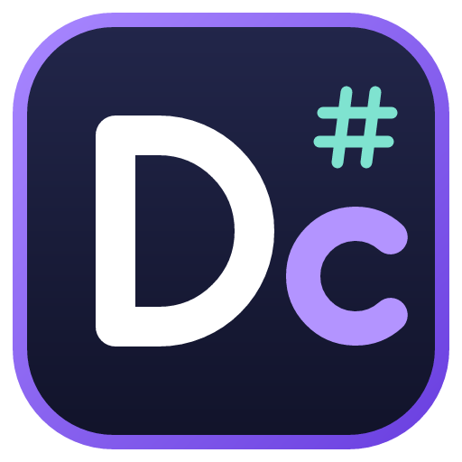
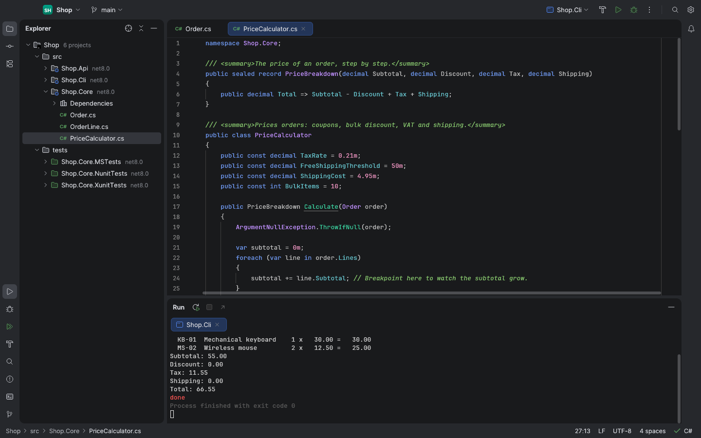
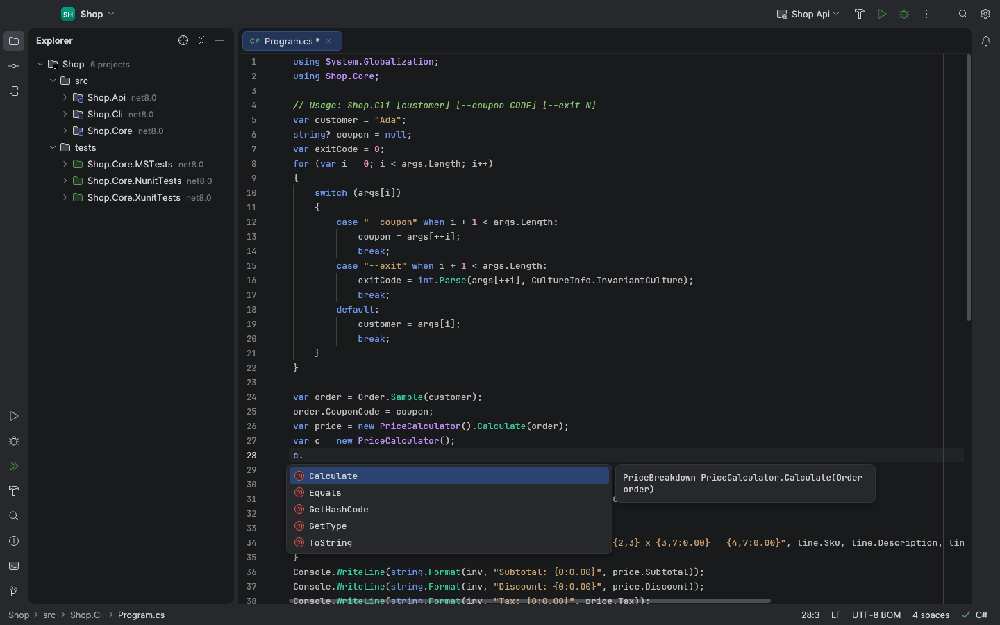
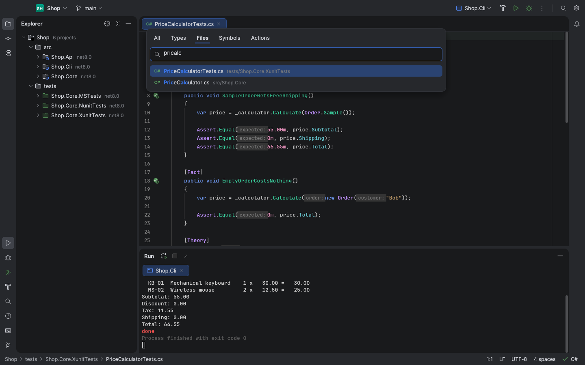
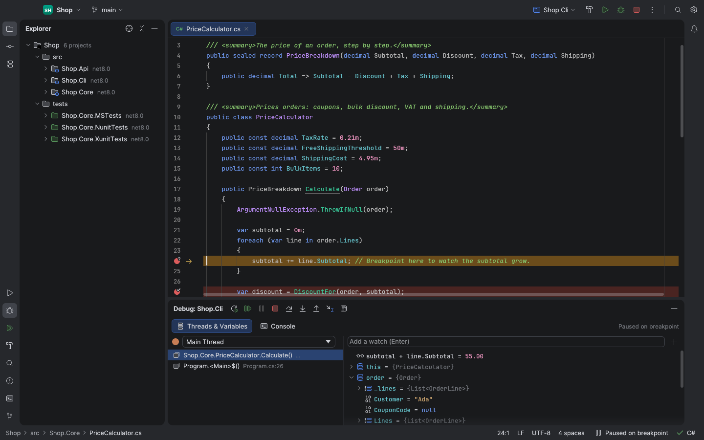
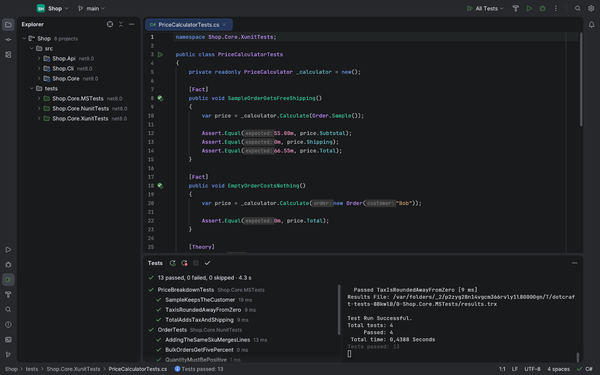
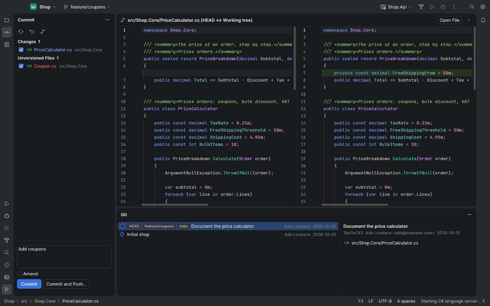
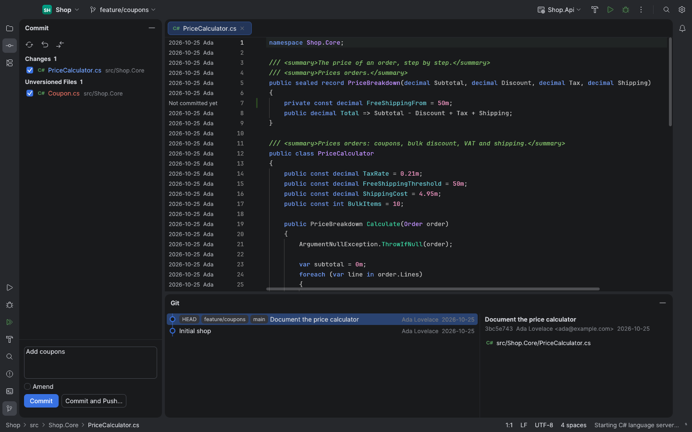

<p align="center">
  
</p>

<h1 align="center">DotCraft</h1>

<p align="center">
  <strong>A lightweight, native IDE for .NET and C#.</strong><br>
  Solutions, Roslyn code intelligence, build, run, tests, debugging and Git in a fast desktop app built with Rust and egui.<br>
  macOS · Windows · Linux
</p>

<p align="center">
  <a href="LICENSE-MIT"></a>
  
  
</p>

<p align="center">
  <a href="#highlights">Highlights</a> ·
  <a href="#requirements">Requirements</a> ·
  <a href="#build-from-source">Build</a> ·
  <a href="#keyboard">Keyboard</a> ·
  <a href="#architecture">Architecture</a> ·
  <a href="#license">License</a>
</p>

<p align="center">
  <picture>
    <source media="(prefers-color-scheme: light)" srcset="docs/screenshots/workspace-light.png">
    
  </picture>
  <br>
  <sub>A solution open in DotCraft. Light and dark themes follow the system.</sub>
</p>

DotCraft takes its layout and keyboard from JetBrains Rider's New UI — islands, tool window stripes, Search Everywhere, the Rider keymap — and runs as a single native binary that starts in a moment and stays responsive on large files. Screenshots are offscreen captures of the current source build on macOS with the sample solution in `tests/fixtures/Shop`.

## Highlights

| Edit | Build and debug | Navigate and review |
| --- | --- | --- |
| A custom editor with tree-sitter highlighting, folding, multi-caret editing and Roslyn semantic colors, completion, signature help, quick fixes, rename and inlay hints. | Build, run and test (xUnit, NUnit, MSTest) with the dotnet CLI; debug console and ASP.NET apps with netcoredbg, and .NET Aspire app hosts with all their services; manage NuGet packages. | Search Everywhere, Find in Files, recent files and locations, an integrated terminal, and Git: changes, commit, branches, side-by-side diff, gutter marks and blame. |

### Code intelligence

DotCraft talks to the same C# language server as Visual Studio Code's C# extension (`Microsoft.CodeAnalysis.LanguageServer`). It finds an installed copy or downloads it on first use. Completion, hover, go to definition and implementations, find usages, cross-project rename, code actions and diagnostics come from Roslyn; syntax colors and structure come from tree-sitter, so the editor is useful before the server is ready.

<table>
  <tr>
    <td width="50%"></td>
    <td width="50%"></td>
  </tr>
  <tr>
    <td align="center"><sub>Completion with documentation.</sub></td>
    <td align="center"><sub>Search Everywhere (⇧⇧) with fuzzy matching.</sub></td>
  </tr>
</table>

### Run, test and debug

Run configurations are created from the solution: one per executable project and launch profile, plus the tests of each test project. Build errors go to the Problems window with links to the code; test results show in a tree and as gutter icons next to each test.

The debugger uses [netcoredbg](https://github.com/Samsung/netcoredbg) (MIT), downloaded on first use. It supports line and conditional breakpoints, step over/into/out, Run to Cursor, threads and frames, a lazily expanded variables tree, watches, Evaluate Expression, values on hover and stopping on exceptions.

Evaluation without side effects: with **Allow property evaluation and other implicit function calls** off (Settings › Tools, or the Variables toolbar and context menu), hovers, watches and the Variables tree never run property getters, indexers or user-defined operators. netcoredbg runs getters for every member it reads or lists, so DotCraft only sends expressions it can prove harmless (locals, literals and arithmetic on primitive values) and objects are expanded on request; the rest shows *Evaluation disabled: may have side effects (click to evaluate)*. **Allow method calls in watches** does the same for calls, `new` and assignments. Data breakpoints and the memory view are not available: netcoredbg does not implement them, so their menu entries are disabled.

<table>
  <tr>
    <td width="50%"></td>
    <td width="50%"></td>
  </tr>
  <tr>
    <td align="center"><sub>Paused on a conditional breakpoint.</sub></td>
    <td align="center"><sub>Tests from three frameworks in one run.</sub></td>
  </tr>
</table>

### .NET Aspire

An Aspire app host (a project with `IsAspireHost`, the `Aspire.AppHost.Sdk` or the `Aspire.Hosting.AppHost` package) gets run configurations with the Aspire icon, one per launch profile. **Run** starts it like any project; its console links the dashboard login URL, and **Open Dashboard** (Run window, Services window, **Run › Open Aspire Dashboard**) opens it.

**Debug** debugs the app host and every .NET project it starts: DotCraft acts as the IDE of Aspire's [IDE execution protocol](https://github.com/dotnet/aspire/blob/main/docs/specs/IDE-execution.md), the one Visual Studio and Rider use, so the orchestrator asks DotCraft to launch each service and each one runs under its own netcoredbg session from its first line. The Debug window shows one tab per process; a service that stops at a breakpoint comes to the front. The services' output still reaches the dashboard.

The **Services** window lists the app host's resources (projects, containers, executables) with their state, health and endpoints, streamed from the app host's resource service (the one the dashboard reads), with Start, Stop and Restart and each resource's console. The `aspire` CLI is not needed.

### Git

Right-click the line numbers (or use **Git › Annotate with Git Blame**) to show who last changed each line; hover an annotation for its commit, click it to find the commit in the Git log, and right-click the column to close it. Code Vision shows the last author of each C# declaration, with "+N" when others changed it too (**Settings › Editor › Show code authors in Code Vision**).

<table>
  <tr>
    <td width="50%"></td>
    <td width="50%"></td>
  </tr>
  <tr>
    <td align="center"><sub>Side-by-side diff with the editor's highlighting.</sub></td>
    <td align="center"><sub>Blame in the gutter.</sub></td>
  </tr>
</table>

### XAML preview

`.axaml` files, and `.xaml` files of Avalonia projects, open beside a live preview, switched with the Editor / Editor and Preview / Preview buttons at the top right as for Markdown. DotCraft runs Avalonia's own previewer (`Avalonia.Designer.HostApp` from the project's Avalonia package, the one Rider and the Avalonia extensions use) inside the built application: build the project once (the preview has a Build button), then the view follows your typing. XAML errors show under the view with their line, and in the editor and the Problems window. The bar under the preview zooms (fit, 100%, in and out) and offers a build when the code changed since the last one; the previewer restarts by itself after a build. XAML in a class library is previewed inside an application of the solution that references it.

.NET MAUI, WPF and WinUI have no previewer outside Visual Studio's designers, so their XAML files show a note instead: run the app to see them.

### Unity projects

Open the folder of a Unity project (the one with `Assets` and `ProjectSettings`) with **File › Open…**. DotCraft opens the `.sln` Unity generated, and the C# code intelligence uses Unity's generated projects. Unity writes those files only for the editors of its IDE packages: if they are missing or out of date, choose Visual Studio or Visual Studio Code in Unity's **Preferences › External Tools**, click **Regenerate project files**, then choose DotCraft again. DotCraft reminds you of this when a Unity folder has no solution or projects yet.

To open Unity's scripts in DotCraft (double-click in the Project window or the Console), choose DotCraft as **External Script Editor** in **Preferences › External Tools** and set **External Script Editor Args** to `--unity $(ProjectPath) $(File) $(Line) $(Column)`. On macOS and Linux a running DotCraft window opens the file at that line.

Unity's cache folders at the project root (`Library`, `Temp`, `Logs`, `MemoryCaptures`) are left out of the explorer, Search Everywhere, Go to File, Find in Files and file watching, and the explorer hides the `.meta` file next to each asset. Renaming or deleting an asset in the explorer renames or deletes its `.meta` file too, so Unity keeps its references. **Show All Files** shows the hidden entries dimmed.

**Tools › Open in Unity Editor** starts the editor version recorded in `ProjectSettings/ProjectVersion.txt`, so opening never upgrades the project. DotCraft looks in Unity Hub's install folders (`/Applications/Unity/Hub/Editor` on macOS, `C:\Program Files\Unity\Hub\Editor` on Windows, `~/Unity/Hub/Editor` on Linux, and the custom location set in Unity Hub). **Settings › Tools › Unity Editor** takes an editor executable (or `Unity.app`), used for every project, or a folder of editors named by version, searched first.

Play mode, building players and debugging are done in the Unity Editor: Unity runs scripts on Mono, which DotCraft's .NET debugger (netcoredbg) cannot attach to.

### Remote development over SSH and WSL

**File › Open Remote Folder…** opens a folder on another machine over SSH, or inside a WSL distribution. DotCraft talks to a small agent there (`dotcraft-remote-agent`) through your `ssh` client and its configuration (keys, ssh-agent, `~/.ssh/config`, known_hosts) or through `wsl.exe`. It cannot answer password or new host key prompts, so connect once from a terminal first.

The agent installs itself: on connect DotCraft asks the machine for its system (`uname`) and looks for `~/.dotcraft/remote/<version>/`, where `<version>` is DotCraft's own, so app and agent always match. When it is missing, the machine downloads `rc-remote-<version>-<platform>.tar.gz` from the GitHub release with curl or wget; if it cannot reach GitHub, DotCraft downloads the archive and copies it over the connection. Either way the archive must match its published SHA-256 before it is unpacked. Agents exist for Linux x64 and ARM64 (statically linked, any distribution) and macOS. To use another agent, a dev build for instance, choose **Agent › Custom path** in the dialog; the dialog shows how to build one by hand with `cargo install --locked --git https://github.com/javy-fernandez/dotcraft --tag v<version> rc-remote`.

The back end runs on the remote machine, like Rider's: the C# language server (Roslyn) and the debugger (netcoredbg) are installed there the first time, in `~/.dotcraft/remote/roslyn/<version>/` and `~/.dotcraft/remote/netcoredbg/<release>/` (DotCraft downloads them for the remote platform and copies them over; netcoredbg is the release the remote glibc runs), and they work on the remote files with the remote SDK. Everything goes through the one agent connection, which streams process input and output.

With the folder open:

- DotCraft copies the folder (without `bin`, `obj`, `.git` and tool caches) to a local mirror, so files open in ordinary editor tabs. A file is fetched again when it opens, and every save goes back to the remote machine; a save that would overwrite a change made there meanwhile is refused.
- Code insight comes from Roslyn on the remote machine: diagnostics, completion, hover, parameter info, go to declaration (other files, framework sources), find usages, rename across files, quick fixes and formatting.
- **Build**, **Test** and **SDK Info** run `dotnet` there on the selected project or solution, with the output streamed into a console tab; **Stop** ends the whole process tree on the remote machine. Paths in the output open the files.
- **Debug** builds the selected project there and debugs it with the remote netcoredbg in the Debug window: breakpoints set in the editor, stepping, the stack, variables, watches and evaluation.
- **Run** starts `dotnet run` in a terminal tab over SSH or WSL, with live output and input; closing the tab stops it. The Terminal tool window opens shells on the remote machine, in the folder.
- **Find in Files** searches the local copy; replacements are saved back like edits.

Not remote yet: Git (use git in a remote terminal), Search Everywhere, run configurations and launch profiles (Debug launches the project's program directly), and files changed on the remote machine are not reloaded until they are opened again. Roslyn needs the .NET 10 runtime on the remote machine.

## Requirements

- macOS 11 or later (Apple Silicon or Intel), Windows 10/11 (x64 or ARM64, DirectX 12), or Linux with glibc 2.35+ (x64 or ARM64; Vulkan or OpenGL ES, X11 or Wayland).
- The [.NET SDK](https://dotnet.microsoft.com/download) 8 or later. DotCraft looks in the default install locations and on `PATH`; another location can be set in **Settings › Tools**.
- Git on `PATH` for the Git features.
- For Unity projects, optionally the Unity Editor installed with Unity Hub (to use **Open in Unity Editor**).
- For remote folders, an OpenSSH client (or WSL on Windows). The remote machine runs Linux (x64 or ARM64) or macOS with the .NET SDK (and the .NET 10 runtime for code insight) and `tar`; curl or wget and `sha256sum` or `shasum` let it download the agent itself.
- An internet connection the first time you open a C# file or start debugging, unless the language server and netcoredbg are already installed (their paths can be set in **Settings › Tools**).

The interface is available in English, Spanish, German, French, Japanese, Polish, Brazilian Portuguese and Simplified Chinese.

## Build from source

DotCraft needs Rust 1.90 or later (edition 2024).

```bash
cargo run --release -p rc-app
```

Packages for distribution:

```bash
scripts/bundle.sh --universal --dmg --zip
```

```bash
scripts/bundle.sh --windows
```

The first builds `DotCraft.app`, a universal `.dmg` and a `.zip` in `target/release`; the second cross-compiles the Windows x64 and ARM64 executables with [cargo-xwin](https://github.com/rust-cross/cargo-xwin) and zips them. Linux builds come from the `Linux release build` workflow (`.github/workflows/linux.yml`), which runs on Ubuntu 22.04 when a release is published and attaches `DotCraft-<version>-linux-x64.tar.gz` and `-linux-arm64.tar.gz`; on Linux, `cargo build --release` is enough. Application icons are generated from `assets/icon.svg` with `scripts/make_icon.py`.

### Tests

```bash
cargo test --workspace
```

Integration tests run against the real .NET SDK, the Roslyn language server and netcoredbg (downloaded once into `target/test-home`) using the solutions in `tests/fixtures`. Window captures are rendered offscreen with the GPU and written to `target/snapshots`:

```bash
cargo test -p rc-app -- --ignored
```

## Keyboard

DotCraft ships the Rider keymap for macOS and for Windows/Linux, and a Visual Studio keymap (**Settings › Keymap**). Some of the defaults:

| Action | macOS (Rider) | Windows (Rider) |
| --- | --- | --- |
| Search Everywhere | ⇧⇧ or ⌘T | Shift Shift or Ctrl+T |
| Go to File / Type / Symbol | ⇧⌘O / ⌘O / ⌥⇧⌘O | Ctrl+Shift+N / Ctrl+N / Ctrl+Alt+Shift+N |
| Quick fixes | ⌥↩ | Alt+Enter |
| Rename | ⇧F6 | Shift+F6 |
| Build / Run / Debug | ⌘F9 / ⌃R / ⌃D | Ctrl+Shift+F9 / Ctrl+F5 / F5 |
| Step over / into / out | F8 / F7 / ⇧F8 | F10 / F11 / Shift+F11 |
| Toggle breakpoint | ⌘F8 | F9 |
| Commit | ⌘K | Ctrl+K |

## Architecture

DotCraft is a Cargo workspace; each crate has one job:

| Crate | Purpose |
| --- | --- |
| `rc-app` | The application: window, tool windows, dialogs, wiring |
| `rc-kit` | Theme (Islands), icons, window chrome, i18n |
| `rc-editor` | Editor widget, keymaps, popups |
| `rc-text` | Rope buffer, selections, edits and undo |
| `rc-syntax` | tree-sitter parsing, highlighting, folding and structure |
| `rc-lsp` | LSP client and the Roslyn language server |
| `rc-dap` | DAP client and netcoredbg sessions |
| `rc-dotnet` | dotnet CLI: solutions, projects, build, run, tests, NuGet |
| `rc-vcs` | Git through the `git` CLI |
| `rc-search` | File index, fuzzy search and Find in Files |
| `rc-term` | Terminal emulator (alacritty_terminal) |
| `rc-remote` | Remote folder agent, its protocol and its installation over SSH and WSL |
| `rc-core` | Settings, sessions, workspace, background work |

See [docs/architecture.md](docs/architecture.md) and [docs/performance.md](docs/performance.md).

## License

Licensed under either of [Apache License, Version 2.0](LICENSE-APACHE) or [MIT license](LICENSE-MIT) at your option.

Icons in `assets/icons` come from the [IntelliJ Platform](https://github.com/JetBrains/intellij-community) (Apache 2.0); see [assets/icons/NOTICE.md](assets/icons/NOTICE.md). DotCraft is not affiliated with JetBrains or Microsoft.
